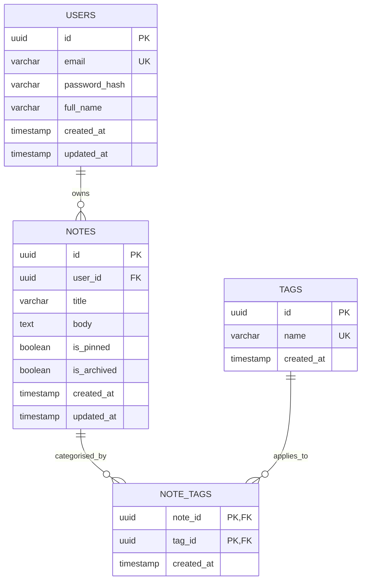

# QuickNotes Data Model Specification

This document details the database architecture for the QuickNotes application, including entity relationships, relational DDL schemas (`CREATE TABLE`), index design, representative queries, and a comparative justification of SQL versus NoSQL.

---

## 1. Entities & Relational Schema Design

QuickNotes defines four core entities:
1. **User (`users`):** Stores user credentials, identity, and profile metadata.
2. **Note (`notes`):** Stores user notes, including titles, bodies, and status flags.
3. **Tag (`tags`):** Stores reusable categorisation labels.
4. **NoteTag (`note_tags`):** Many-to-many junction table associating notes with tags.

### Entity-Relationship Diagram (ERD)



---

## 2. Relational Schema (`CREATE TABLE` Statements)

```sql
-- Enable UUID extension (PostgreSQL)
CREATE EXTENSION IF NOT EXISTS "uuid-ossp";

-- 1. Users Table
CREATE TABLE users (
    id UUID PRIMARY KEY DEFAULT uuid_generate_v4(),
    email VARCHAR(255) NOT NULL UNIQUE,
    password_hash VARCHAR(255) NOT NULL,
    full_name VARCHAR(100) NOT NULL,
    created_at TIMESTAMP WITH TIME ZONE DEFAULT CURRENT_TIMESTAMP NOT NULL,
    updated_at TIMESTAMP WITH TIME ZONE DEFAULT CURRENT_TIMESTAMP NOT NULL
);

-- 2. Notes Table
CREATE TABLE notes (
    id UUID PRIMARY KEY DEFAULT uuid_generate_v4(),
    user_id UUID NOT NULL REFERENCES users(id) ON DELETE CASCADE,
    title VARCHAR(100) NOT NULL,
    body TEXT NOT NULL,
    is_pinned BOOLEAN DEFAULT FALSE NOT NULL,
    is_archived BOOLEAN DEFAULT FALSE NOT NULL,
    created_at TIMESTAMP WITH TIME ZONE DEFAULT CURRENT_TIMESTAMP NOT NULL,
    updated_at TIMESTAMP WITH TIME ZONE DEFAULT CURRENT_TIMESTAMP NOT NULL
);

-- 3. Tags Table
CREATE TABLE tags (
    id UUID PRIMARY KEY DEFAULT uuid_generate_v4(),
    name VARCHAR(50) NOT NULL UNIQUE,
    created_at TIMESTAMP WITH TIME ZONE DEFAULT CURRENT_TIMESTAMP NOT NULL
);

-- 4. Note Tags (Junction Table for Many-to-Many relationship)
CREATE TABLE note_tags (
    note_id UUID NOT NULL REFERENCES notes(id) ON DELETE CASCADE,
    tag_id UUID NOT NULL REFERENCES tags(id) ON DELETE CASCADE,
    created_at TIMESTAMP WITH TIME ZONE DEFAULT CURRENT_TIMESTAMP NOT NULL,
    PRIMARY KEY (note_id, tag_id)
);
```

---

## 3. Database Indexes

To achieve low-latency reads (<50ms) and optimize frequent query patterns, the following indexes are defined:

```sql
-- Index foreign key on notes table to speed up retrieving notes for a user
CREATE INDEX idx_notes_user_id ON notes(user_id);

-- Composite index to support sorting active notes by pinned status and recency
CREATE INDEX idx_notes_user_active ON notes(user_id, is_archived, is_pinned DESC, updated_at DESC);

-- Index for searching tags by name
CREATE INDEX idx_tags_name ON tags(name);

-- Index reverse lookup on junction table (finding all notes with a specific tag)
CREATE INDEX idx_note_tags_tag_id ON note_tags(tag_id);

-- Full-text search index on title and body
CREATE INDEX idx_notes_search ON notes USING gin(to_tsvector('english', title || ' ' || body));
```

---

## 4. Example Queries

### 4.1. Create a New Note
```sql
INSERT INTO notes (user_id, title, body, is_pinned)
VALUES ('a0eebc99-9c0b-4ef8-bb6d-6bb9bd380a11', 'Architecture Review', 'Prepare diagram and review cache layer.', TRUE)
RETURNING id, title, body, is_pinned, created_at;
```

### 4.2. List Recent Active Notes for a User (Paginated)
```sql
SELECT 
    n.id, 
    n.title, 
    n.body, 
    n.is_pinned, 
    n.updated_at,
    COALESCE(ARRAY_AGG(t.name) FILTER (WHERE t.name IS NOT NULL), '{}') AS tags
FROM notes n
LEFT JOIN note_tags nt ON n.id = nt.note_id
LEFT JOIN tags t ON nt.tag_id = t.id
WHERE n.user_id = 'a0eebc99-9c0b-4ef8-bb6d-6bb9bd380a11'
  AND n.is_archived = FALSE
GROUP BY n.id
ORDER BY n.is_pinned DESC, n.updated_at DESC
LIMIT 10 OFFSET 0;
```

### 4.3. Filter Notes by Tag
```sql
SELECT n.id, n.title, n.body, n.updated_at
FROM notes n
JOIN note_tags nt ON n.id = nt.note_id
JOIN tags t ON nt.tag_id = t.id
WHERE n.user_id = 'a0eebc99-9c0b-4ef8-bb6d-6bb9bd380a11'
  AND t.name = 'work'
  AND n.is_archived = FALSE
ORDER BY n.updated_at DESC;
```

### 4.4. Full-Text Search Across Notes
```sql
SELECT id, title, ts_headline('english', body, to_tsquery('english', 'cache | redis')) AS snippet
FROM notes
WHERE user_id = 'a0eebc99-9c0b-4ef8-bb6d-6bb9bd380a11'
  AND to_tsvector('english', title || ' ' || body) @@ to_tsquery('english', 'cache | redis')
ORDER BY updated_at DESC;
```

### 4.5. Delete a Note (Cascades to `note_tags`)
```sql
DELETE FROM notes
WHERE id = 'c1eebc99-9c0b-4ef8-bb6d-6bb9bd380a22'
  AND user_id = 'a0eebc99-9c0b-4ef8-bb6d-6bb9bd380a11';
```

---

## 5. SQL vs. NoSQL Justification

For QuickNotes, a **Relational Database (PostgreSQL)** was selected over a Document-based NoSQL alternative (such as MongoDB or DynamoDB) based on the following architectural evaluation:

| Criterion | Relational (PostgreSQL) - Selected | NoSQL (MongoDB / DynamoDB) |
| :--- | :--- | :--- |
| **Data Relational Structure** | Natural fit for many-to-many relationships (Notes $\leftrightarrow$ Tags) and strict ownership references (`users` $\leftrightarrow$ `notes`). | Requires embedding tags (causing duplication & sync overhead) or manual application-level joins. |
| **ACID Guarantees & Consistency** | Full multi-table ACID transactions ensure consistency across note creation, tag mapping, and deletions. | Eventual consistency or single-document ACID by default; multi-document transactions incur performance penalties. |
| **Data Integrity & Constraints** | Enforced at the engine layer via foreign key cascades, unique constraints, and schema validations. | Relies on application logic for referential integrity, creating risk of orphaned junction records. |
| **Search & Query Flexibility** | Native GIN index support for full-text search, composite indexes, and aggregate joining. | Flexible schema, but complex filtering across relations requires secondary indexing or external search engines. |
| **Write and Storage Scale** | 1M DAU generates ~23 writes/sec and ~876 GB/year—well within the performance envelope of a single PostgreSQL primary with read replicas. | Excels at high write throughput (100k+ WPS), but unnecessary overkill for QuickNotes' estimated workload. |

### Conclusion
PostgreSQL provides robust referential integrity, built-in full-text search capabilities, and ACID reliability without adding unnecessary architectural complexity, making it the ideal primary datastore for QuickNotes.
